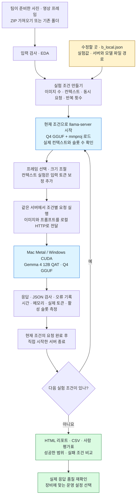

# filename · B — 로컬 실행 용량 실험

선택 모델: **`google/gemma-4-12b-qat`**. llama-server로 이미지 수·컨텍스트·동시 요청·모델 재사용 한계를 측정합니다.

평가 데이터는 팀이 ZIP으로 업로드합니다. 사진·프레임·정답을 생성하는 기능은 없습니다.

## 동작 구조

**실제 로컬 장비에서 입력량과 동시 요청 수를 바꾸며 실행 가능한 범위를 측정합니다.** 아래는 실제 모델을 사용하는 실행 흐름입니다.



- **조건마다 서버를 새로 시작합니다.** 같은 조건 안에서는 서버를 유지합니다. `soak` 실험은 한 프로세스에서 기본 100회 요청해 모델 재사용을 확인합니다.
- **이미지 수와 동시 요청 수를 구분합니다.** 영상 3프레임을 한 요청에 넣는 것과, 독립 요청 3건을 동시에 보내는 것은 다른 실험입니다.
- **컨텍스트는 실제 사용량도 확인합니다.** `context` 실험은 먼저 입력 토큰을 측정하고 중립 텍스트로 기본 약 75% 점유를 목표로 보정합니다. 이 입력은 용량 측정용입니다.

메모리 부족·시간 초과·서버 오류가 발생하면 직접 시작한 서버를 종료하고 실행을 멈춘 뒤, 확보한 기록으로 리포트를 만듭니다. NVIDIA VRAM은 `nvidia-smi`, 프로세스 RAM은 `psutil`로 측정합니다. Mac의 NVIDIA VRAM 항목은 빈값이며 통합 메모리 전체 사용량을 뜻하지 않습니다.

`--dry-run`은 입력·계획만 확인하고, `--mock`은 실제 서버 대신 고정 응답을 사용합니다. 선택적으로 제공한 정답은 평가에만 사용합니다. 서버는 로컬 주소 `127.0.0.1`로 통신합니다.

코드에서 따라갈 순서: [입력·프레임 처리](filename_bench/data.py) → [실험 반복](filename_bench/runner.py) → [서버 시작·요청·종료](filename_bench/backends.py) → [메모리·슬롯 측정](filename_bench/telemetry.py) → [리포트](filename_bench/report.py).

## 먼저 바꿀 설정

`configs/b_local.json`에서 `server_path`, `model_path`, `mmproj_path`를 실제 파일 위치로 바꾸세요. 기본 파일명은 LM Studio의 Gemma 4 12B QAT Q4_0에 맞췄습니다. Mac에서도 경로를 실제 위치로 바꿉니다. [모델 구분](docs/MODEL.md)

B는 조건마다 직접 llama-server를 시작합니다. 실제 8GB VRAM 실행 가능 여부는 장비에서 측정해야 합니다. [설정값 설명](docs/CODE_GUIDE.md)

## 터미널에서 시작하기

Python 3.10 이상을 사용합니다.

```bash
git clone https://github.com/yooongZa/filename-local-capacity-bench.git
cd filename-local-capacity-bench
python -m venv .venv
# macOS/Linux: source .venv/bin/activate
# Windows PowerShell: .venv\Scripts\Activate.ps1
python -m pip install -r requirements.txt
python upload_dataset.py evaluation.zip --destination data/evaluation
```

마지막 명령이 출력한 실제 데이터 경로를 아래 `--dataset-root`에 넣습니다. 폴더 구조는 [데이터 업로드 안내](docs/DATASET.md)를 참고하세요.

```bash
python b_capacity.py --dataset-root data/evaluation --dry-run
python b_capacity.py --dataset-root data/evaluation --mock --run-dir runs/first_check
```

모의 실행은 고정 응답으로 저장·검사·리포트를 확인합니다. `--mock`을 빼면 설정에 지정한 모델 파일로 llama-server를 실행합니다. 모델 파일은 직접 준비합니다.

## 코드를 읽고 수정할 때

먼저 [초보자 코드 안내](docs/CODE_GUIDE.md)의 수정 위치 표를 보세요. 입력 설정과 모델 지시문을 바꾸는 데 내부 실행 코드를 수정할 필요는 없습니다.

- [실험 실행 방법](docs/EXPERIMENTS.md): 조건별 실행과 해석
- [평가 방법](docs/EVALUATION.md): 자동 지표와 사람 평가표
- [재개·오류 처리](docs/RELIABILITY.md): 실패·중단·재시도
- [검증 기록](VALIDATION.md): 확인한 범위와 미실행 항목

기본 결과는 `runs/b/<suite>/`에 저장됩니다. `--run-dir`로 바꿀 수 있습니다. JSONL 원문, CSV 지표·사람 평가표, HTML 리포트를 생성합니다. 데이터·모델·결과·개인 설정은 Git에서 제외합니다. 참조 답안 없이도 실행할 수 있습니다.

짝 프로젝트: [yooongZa/filename-model-quality-bench](https://github.com/yooongZa/filename-model-quality-bench)

**Based-On: none** — 대응하는 멀티모달 품질·용량 LMS 예제가 없어 별도로 작성한 `project_extension`입니다. LMS 원문은 포함하지 않습니다.
