# filename · B — 로컬 실행 용량 실험

선택 모델: **`google/gemma-4-12b-qat`**. llama-server로 이미지 수·컨텍스트·동시 요청·모델 재사용 한계를 측정합니다.

평가 데이터는 팀이 ZIP으로 업로드합니다. `videos/`에 원본 영상을 넣으면 FFmpeg로 대표 프레임을 추출합니다. 기본은 10초당 1장·최대 5장입니다. [추출 설정](docs/VIDEO_FRAMES.md)을 참고하세요. 평가 사진과 정답은 합성하지 않습니다.

이 테스트는 **입력량·동시 요청 수·반복 횟수를 바꿔 가며, 처리 시간과 메모리 사용량, 응답의 정상 여부를 확인**해요. 요소를 **바꾸는 조건**과 **측정하는 결과**로 나누면 이해하기 쉽습니다.

**1. 바꿔 보는 조건**

| 요소 | 의미 | 이 저장소에서 확인하는 방식 |
|---|---|---|
| **Context(문맥 공간)** | 모델이 한 요청에서 입력과 생성할 답변을 담을 수 있는 토큰 공간 | 4K·8K·16K·32K로 설정하고, 입력으로 약 75%를 채워 처리 가능 여부 확인 |
| **Token(토큰)** | 텍스트나 이미지를 모델이 처리할 때 사용하는 내부 단위. 글자 수와는 계산 방식이 다름 | 실제 입력이 얼마나 많은 토큰을 차지하는지 기록 |
| **Image count(이미지 수)** | 한 요청에 들어가는 이미지의 개수 | 같은 영상에서 뽑은 1·3·6·12프레임을 넣어 비교 |
| **Concurrency(동시 요청 수)** | 서로 독립된 요청을 한꺼번에 보내는 개수 | 1·2·4·8건을 동시에 보내 처리 상태 확인 |
| **Model reuse(모델 재사용)** | 메모리에 올린 모델을 유지하면서 다음 요청에도 계속 사용하는 것 | 같은 모델 프로세스로 100회 연속 요청 |

예를 들어 **영상 프레임 6장을 한꺼번에 분석해서 답변 하나를 받는 것**이 이미지 수 실험이에요. **사진 분석 요청 4건을 동시에 보내 답변 4개를 받는 것**은 동시 요청 실험입니다. [실험 구성](https://github.com/yooongZa/filename-local-capacity-bench/blob/main/docs/EXPERIMENTS.md)

**2. 그 결과로 측정하는 값**

| 측정 요소 | 의미 | 결과를 읽는 방법 |
|---|---|---|
| **VRAM(GPU 메모리)** | GPU가 모델과 계산에 사용하는 메모리 | 입력이나 동시 요청이 늘어날 때 메모리가 얼마나 증가하는지 확인 |
| **RAM(주 메모리)** | 서버 프로그램이 사용하는 컴퓨터 메모리 | 반복 실행하면서 사용량이 계속 증가하는지 확인 |
| **Latency(응답 지연 시간)** | 요청을 보낸 뒤 답변이 끝날 때까지 걸린 시간 | 이미지 수나 입력 길이가 늘면서 얼마나 느려지는지 확인 |
| **그룹 처리 시간** | 동시에 보낸 요청 묶음이 모두 끝날 때까지 걸린 시간 | 여러 건을 함께 처리할 때 전체 작업 시간이 어떻게 달라지는지 확인 |
| **Active slots(활성 처리 슬롯)** | 서버에서 요청을 처리 중인 자리의 관측 개수 | 동시에 보낸 요청 중 실제 처리 중으로 관측된 요청 수 확인 |
| **실행 상태** | 요청이 완료됐는지, 오류가 발생했는지 | 메모리 부족, 시간 초과, 서버 오류, 답변 잘림 등을 구분 |
| **JSON·Schema(출력 구조) 준수** | 응답을 프로그램이 읽을 수 있고 정해진 필드·자료형을 지켰는지 | 필수 필드 누락, 잘못된 자료형, 태그 개수 초과 등을 검사 |

메모리는 측정 범위에 주의해야 해요. 이 코드는 **NVIDIA GPU 전체 메모리 사용량**과 **서버 프로세스의 RAM**을 측정합니다. 따라서 다른 GPU 프로그램의 사용량도 VRAM 수치에 포함될 수 있고, Mac에서는 NVIDIA VRAM 항목이 비어 있습니다. [측정 방식](https://github.com/yooongZa/filename-local-capacity-bench/blob/main/docs/EXPERIMENTS.md)

**3. 비교할 때 기준으로 유지하는 설정**

여러 조건을 한꺼번에 바꾸면 원인을 알기 어려워서, 기본적으로 다음 설정을 유지하면서 실험 요소 하나씩을 변경합니다.

| 설정 | 기본값 | 의미 |
|---|---:|---|
| 이미지 짧은 변 | 720px | 모델에 보내기 전 이미지 크기를 맞추는 기준 |
| 최대 출력 토큰 | 256 | 모델이 생성할 답변 길이의 상한 |
| Temperature(생성 무작위성) | 0 | 답변 생성의 무작위성을 낮추는 설정 |
| Seed(난수 시드) | 42 | 반복 실험의 조건을 맞추기 위한 난수 기준값 |
| 조건별 반복 | 3회 | 같은 조건을 반복해 시간과 성공 여부 등을 확인하는 횟수 |

`smoke`는 이런 본 실험에 앞서 **모델 로드 → 이미지 입력 → JSON 응답**이 연결되는지 확인하는 기본 작동 검사예요. [설정 파일](https://github.com/yooongZa/filename-local-capacity-bench/blob/main/configs/b_local.json)

## 로컬 파일 정리 프로그램

[Windows·Mac 앱 사용법](docs/APP.md) · [공통 config 사용법](docs/CONFIG.md)

`python app.py`로 **폴더 선택 → 분석 → 파일명 검토 → 변경** 화면을 엽니다. Gemma 4 12B QAT 모델이 있으면 연결하고, 없으면 다운로드합니다. 원래 파일명에 태그 5개를 붙이며 검토·자동 변경 옵션과 변경 이력 복원을 제공합니다.

## 동작 구조

**실제 로컬 장비에서 입력량과 동시 요청 수를 바꾸며 실행 가능한 범위를 측정합니다.** 아래는 실제 모델을 사용하는 실행 흐름입니다.



[크게 보기 · PNG](docs/diagrams/flow.png) · [수정 가능한 Mermaid 원본](docs/diagrams/flow.mmd)


- **조건마다 서버를 새로 시작합니다.** 같은 조건 안에서는 서버를 유지합니다. `soak` 실험은 한 프로세스에서 기본 100회 요청해 모델 재사용을 확인합니다.
- **이미지 수와 동시 요청 수를 구분합니다.** 영상 3프레임을 한 요청에 넣는 것과, 독립 요청 3건을 동시에 보내는 것은 다른 실험입니다.
- **컨텍스트는 실제 사용량도 확인합니다.** `context` 실험은 먼저 입력 토큰을 측정하고 중립 텍스트로 기본 약 75% 점유를 목표로 보정합니다. 이 입력은 용량 측정용입니다.

메모리 부족·시간 초과·서버 오류가 발생하면 직접 시작한 서버를 종료하고 실행을 멈춘 뒤, 확보한 기록으로 리포트를 만듭니다. NVIDIA VRAM은 `nvidia-smi`, 프로세스 RAM은 `psutil`로 측정합니다. Mac의 NVIDIA VRAM 항목은 빈값이며 통합 메모리 전체 사용량을 뜻하지 않습니다.

`--dry-run`은 입력·계획만 확인하고, `--mock`은 실제 서버 대신 고정 응답을 사용합니다. 선택적으로 제공한 정답은 평가에만 사용합니다. 서버는 로컬 주소 `127.0.0.1`로 통신합니다.

코드에서 따라갈 순서: [입력·프레임 처리](filename_bench/data.py) → [실험 반복](filename_bench/runner.py) → [서버 시작·요청·종료](filename_bench/backends.py) → [메모리·슬롯 측정](filename_bench/telemetry.py) → [리포트](filename_bench/report.py).

## 먼저 바꿀 설정

`configs/b_local.json`에서 `server_path`, `model_path`, `mmproj_path`를 실제 파일 위치로 바꾸세요. 기본 파일명은 LM Studio의 Gemma 4 12B QAT Q4_0에 맞췄습니다. Mac에서도 경로를 실제 위치로 바꿉니다. [모델 구분](docs/MODEL.md)

B는 조건마다 직접 llama-server를 시작합니다. 실제 8GB VRAM 실행 가능 여부는 장비에서 측정해야 합니다. [설정값 설명](docs/CODE_GUIDE.md)

## 터미널에서 시작하기

Python 3.10 이상을 사용합니다.

```bash
git clone https://github.com/yooongZa/filename-local-capacity-bench.git
cd filename-local-capacity-bench
python -m venv .venv
# macOS/Linux: source .venv/bin/activate
# Windows PowerShell: .venv\Scripts\Activate.ps1
python -m pip install -r requirements.txt
python upload_dataset.py evaluation.zip --destination data/evaluation
```

마지막 명령이 출력한 실제 데이터 경로를 아래 `--dataset-root`에 넣습니다. 폴더 구조는 [데이터 업로드 안내](docs/DATASET.md)를 참고하세요.

```bash
python b_capacity.py --dataset-root data/evaluation --dry-run
python b_capacity.py --dataset-root data/evaluation --mock --run-dir runs/first_check
```

모의 실행은 고정 응답으로 저장·검사·리포트를 확인합니다. `--mock`을 빼면 설정에 지정한 모델 파일로 llama-server를 실행합니다. 모델 파일은 직접 준비합니다.

## 코드를 읽고 수정할 때

먼저 [초보자 코드 안내](docs/CODE_GUIDE.md)의 수정 위치 표를 보세요. 입력 설정과 모델 지시문을 바꾸는 데 내부 실행 코드를 수정할 필요는 없습니다.

- [실험 실행 방법](docs/EXPERIMENTS.md): 조건별 실행과 해석
- [평가 방법](docs/EVALUATION.md): 자동 지표와 사람 평가표
- [재개·오류 처리](docs/RELIABILITY.md): 실패·중단·재시도
- [검증 기록](VALIDATION.md): 확인한 범위와 미실행 항목

기본 결과는 `runs/b/<suite>/`에 저장됩니다. `--run-dir`로 바꿀 수 있습니다. JSONL 원문, CSV 지표·사람 평가표, HTML 리포트를 생성합니다. 데이터·모델·결과·개인 설정은 Git에서 제외합니다. 참조 답안 없이도 실행할 수 있습니다.

짝 프로젝트: [yooongZa/filename-model-quality-bench](https://github.com/yooongZa/filename-model-quality-bench)

**Based-On: none** — 대응하는 멀티모달 품질·용량 LMS 예제가 없어 별도로 작성한 `project_extension`입니다. LMS 원문은 포함하지 않습니다.
